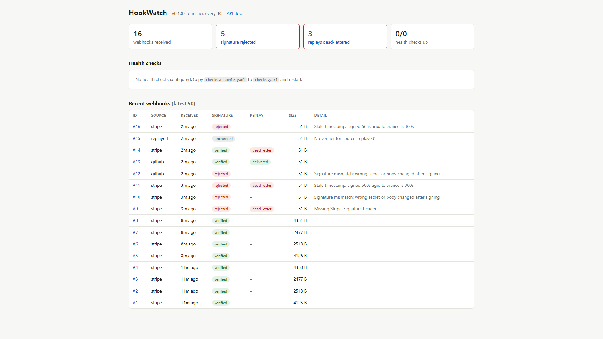
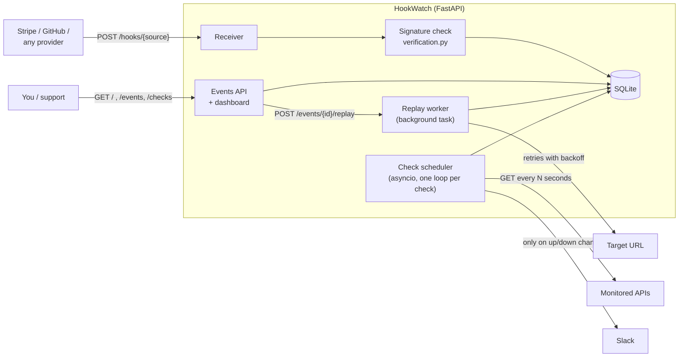

# HookWatch

[](https://github.com/mlouis594/hookwatch/actions/workflows/tests.yml)

Catch, verify, inspect, and replay webhooks, and monitor the health of the APIs you depend on.



HookWatch is the tool I'd want when a customer says "your webhooks stopped working": it shows
every request that arrived, whether its signature checked out and why not, lets you re-send it
with retries, and tells you whether the APIs involved are up.

- **Receive and store** every webhook exactly as it arrived (raw bytes, headers, size).
- **Verify signatures** for Stripe and GitHub with hand-written HMAC-SHA256 checks, and record
  *why* a signature was rejected.
- **Replay** any event to any URL, with exponential-backoff retries and a dead-letter list.
- **Health checks** on a schedule, with Slack alerts only when something goes down or recovers.
- **Dashboard** showing recent webhooks and check status, plus a JSON API for everything.

Built with Python 3.12, FastAPI, SQLModel (SQLite), httpx, and Jinja2. 126 tests, run by GitHub
Actions on every push.

## Contents

- [Architecture](#architecture)
- [Quick start](#quick-start)
- [Configuration](#configuration)
- [Endpoints](#endpoints)
- [Signature verification](#signature-verification)
- [Replay](#replay)
- [Health checks and alerts](#health-checks-and-alerts)
- [Troubleshooting](#troubleshooting)
- [Run it with Docker](#run-it-with-docker)
- [Design decisions and limits](#design-decisions-and-limits)
- [Project layout](#project-layout)

## Architecture



One process does everything: FastAPI serves the receiver, API, and dashboard; replays run as
background tasks; health checks run as asyncio tasks started when the app starts. All state
lives in one SQLite file.

## Quick start

In WSL or Linux:

```bash
python3 -m venv .venv
source .venv/bin/activate
pip install -r requirements-dev.txt

pytest -v                      # run the tests
uvicorn app.main:app --reload  # start the server on http://localhost:8000
```

Open http://localhost:8000 for the dashboard and http://localhost:8000/docs for the interactive
API docs. Send a test webhook:

```bash
curl -X POST http://localhost:8000/hooks/test \
  -H "Content-Type: application/json" \
  -d '{"type": "order.created", "id": 42}'

curl http://localhost:8000/events/1
```

## Configuration

Everything is configured with environment variables. Put them in a `.env` file (gitignored) and
start the server with `uvicorn app.main:app --reload --env-file .env`.

| Variable | Default | What it does |
| --- | --- | --- |
| `STRIPE_WEBHOOK_SECRET` | unset | Stripe signing secret (`whsec_...`). Unset means Stripe events are `unchecked` |
| `GITHUB_WEBHOOK_SECRET` | unset | GitHub webhook secret. Unset means GitHub events are `unchecked` |
| `SLACK_WEBHOOK_URL` | unset | Slack incoming webhook for health-check alerts. Unset means alerts go to the log |
| `HOOKWATCH_CHECKS_FILE` | `checks.yaml` | Health-check config. A missing file means no checks |
| `HOOKWATCH_DB_URL` | `sqlite:///./hookwatch.db` | Database location |

There's no migration tool: after pulling a change to the tables, delete `hookwatch.db` and
restart. Tables are created on startup.

## Endpoints

| Method | Path | What it does |
| --- | --- | --- |
| `GET` | `/` | Dashboard: recent webhooks and health-check status (refreshes every 30 s) |
| `POST` | `/hooks/{source}` | Receive a webhook, verify its signature, and store it (source is lowercase, e.g. `stripe`). Returns 400 if the signature is rejected; the event is stored anyway |
| `GET` | `/events` | List events, newest first. Supports `?source=`, `?signature_status=`, `?replay_status=`, `?limit=`, `?offset=` |
| `GET` | `/events/{id}` | One event in full: headers, raw body, parsed JSON |
| `POST` | `/events/{id}/replay` | Re-send the event to `{"target_url": "..."}` with retries. Returns 202; 409 if a replay is already running |
| `GET` | `/events/{id}/attempts` | Every delivery attempt for the event: status code, error, response excerpt, duration |
| `GET` | `/checks` | Every configured health check: `up`/`down`/`unknown`, last and p95 latency, last error, when it last changed |
| `GET` | `/checks/{name}/results` | Recent runs of one check, newest first. Supports `?limit=` |
| `GET` | `/health` | Liveness check |

`Authorization`, `Proxy-Authorization`, and `Cookie` headers are redacted before storage. Bodies
over 1 MB get a 413.

## Signature verification

Stripe and GitHub sign every webhook with HMAC-SHA256 using a secret only you and they know.
HookWatch recomputes the signature over the **raw body bytes** and compares it in constant time
(`hmac.compare_digest`). The code is in [`app/verification.py`](app/verification.py), written by
hand with `hmac` and `hashlib` rather than a provider SDK.

| Source | Secret env var | Header | What's signed |
| --- | --- | --- | --- |
| `stripe` | `STRIPE_WEBHOOK_SECRET` (`whsec_...`) | `Stripe-Signature: t=<ts>,v1=<hex>` | `"<ts>." + body`; rejected if `ts` is over 5 minutes old |
| `github` | `GITHUB_WEBHOOK_SECRET` | `X-Hub-Signature-256: sha256=<hex>` | `body` |

Every event gets a `signature_status`:

- `verified`: the signature matched.
- `rejected`: missing or malformed header, signature mismatch, or a stale Stripe timestamp.
  `signature_detail` says which. The event is **still stored** so you can inspect it, and the
  sender gets a 400 so the failure shows up on their side too.
- `unchecked`: no secret is set for that source, or the source has no verifier.

Why the details matter:

- **Raw bytes, never re-serialized JSON.** Parsing and re-dumping the body changes whitespace and
  key order, which changes the signature.
- **Constant-time comparison.** `==` stops at the first wrong character, so response timing leaks
  how much of a forged signature was right.
- **Stripe's timestamp is inside the signature.** Rejecting old timestamps stops someone replaying
  a captured request later, and the timestamp can't be swapped without breaking the signature.
- **Multiple `v1` values** appear while you roll a Stripe secret; any match passes.

### Try it with Stripe

```bash
stripe listen --all-snapshot --forward-to localhost:8000/hooks/stripe   # prints a whsec_ secret
echo "STRIPE_WEBHOOK_SECRET=whsec_..." >> .env
uvicorn app.main:app --reload --env-file .env                           # in another terminal
stripe trigger payment_intent.succeeded                                 # in a third
```

### Try it with GitHub (no account needed)

```bash
BODY='{"action":"opened"}'
SIG="sha256=$(printf '%s' "$BODY" | openssl dgst -sha256 -hmac "$GITHUB_WEBHOOK_SECRET" | awk '{print $2}')"
curl -X POST http://localhost:8000/hooks/github -H "X-Hub-Signature-256: $SIG" -d "$BODY"
```

## Replay

`POST /events/{id}/replay` re-sends a stored webhook to any URL, which is useful for re-running a
failed delivery against a fixed endpoint, or sending real traffic to a local build.

- **What's sent:** the original raw body, byte for byte, and the original headers (signature
  headers included), plus `X-HookWatch-Replay: <event id>`. Connection-level headers like `Host`
  are regenerated, and redacted headers are left out.
- **Retries:** connection errors, timeouts, `5xx`, and `429` are retried up to 5 attempts, waiting
  1, 2, 4, then 8 seconds between them (exponential backoff). Other `4xx` responses aren't retried:
  the target understood the request and refused it, so sending it again won't help.
- **Dead letter:** if nothing succeeds, the event's `replay_status` becomes `dead_letter`.
  List them with `GET /events?replay_status=dead_letter`.
- **Background:** the API answers `202 Accepted` immediately and retries run in a background task.
  A second replay of the same event while one is running gets a `409`.

Every attempt is recorded with its status code, error, duration, and the first 500 characters of
the target's response, which usually says exactly why it refused.

```bash
curl -X POST http://localhost:8000/events/1/replay \
  -H "Content-Type: application/json" \
  -d '{"target_url": "http://localhost:8000/hooks/replayed"}'

curl http://localhost:8000/events/1/attempts
```

## Health checks and alerts

List the APIs to watch in `checks.yaml`:

```bash
cp checks.example.yaml checks.yaml   # then edit; checks.yaml is gitignored
```

```yaml
checks:
  - name: GitHub API
    url: https://api.github.com
    interval_seconds: 60        # default 60, minimum 5
    timeout_seconds: 10         # default 10
    expected_status: 200        # default 200
    failures_before_down: 2     # default 1
```

Each check runs on its own interval from the moment the server starts. Every run is stored
(status code, latency, error), and `GET /checks` shows each check's state, its last latency, and
its **p95 latency** over the last 100 runs. p95 rather than the average, because an average
hides the slow tail: 19 fast responses and one 9-second one still average out to "fine".

**Alerts only fire when a check changes state:** once when it goes down, once when it recovers
(with how long the outage lasted). A check that fails for an hour produces one alert, not sixty.
Alerting on every failure trains people to mute the channel, and then real outages get missed.
`failures_before_down` goes further: with `2`, a single failed run doesn't page anyone.

```
🔴 GitHub API is DOWN: Timed out after 10s (GET https://api.github.com)
🟢 GitHub API recovered after 4m 10s (HTTP 200 in 182 ms)
```

Alerts go to Slack when `SLACK_WEBHOOK_URL` is set (an
[incoming webhook](https://api.slack.com/messaging/webhooks) URL), and to the server log
otherwise. Check state is kept in the database, so a restart doesn't re-alert an outage that's
already been reported. An invalid `checks.yaml` stops the server at startup with a message saying
what's wrong.

> Tip: set `SLACK_WEBHOOK_URL=http://localhost:8000/hooks/slack` to have HookWatch catch its own
> alerts, then read them at `/events?source=slack`.

## Troubleshooting

### "Signature mismatch"

The signature HookWatch computed doesn't match the one in the header. In order of likelihood:

1. **Wrong secret.** Each Stripe endpoint and each `stripe listen` session has its own `whsec_`
   secret; the one in the Dashboard for your production endpoint won't match CLI traffic. Use the
   whole string, `whsec_` prefix included. For GitHub, the secret is the one set on that specific
   webhook.
2. **Server not restarted.** Secrets are read from the environment the server was started with.
   After editing `.env`, restart uvicorn.
3. **The body changed.** Something between the sender and HookWatch (a proxy, a framework that
   parses and re-encodes JSON) altered the bytes. Compare `size_bytes` with the size the provider
   reports.

### "Stale timestamp"

The Stripe signature is valid, but it was made more than 5 minutes ago. Usually:

- **The server's clock is wrong.** Check it with `date -u`. WSL's clock can drift after the laptop
  sleeps; `sudo hwclock -s` resyncs it.
- **The request was delayed or re-sent**, for example a replay of an old event (see below).

### A replay fails or ends in `dead_letter`

Check `GET /events/{id}/attempts`: each attempt has the status code, error, and the start of the
target's response.

- **`400` from a target that verifies Stripe signatures, saying the timestamp is too old.** This is
  expected. A replay carries Stripe's original signature, and its timestamp is part of what's
  signed. After 5 minutes the target rejects it, and HookWatch can't re-sign it without the
  target's secret. Use Stripe's own **Resend** (Dashboard, or `stripe events resend <evt_id>`),
  which signs with a fresh timestamp.
- **`ConnectError` / timeouts on every attempt.** The target isn't reachable from where HookWatch
  runs. Inside Docker, `localhost` means the container itself; use `host.docker.internal`.
- **`404` / `401` / `403`.** Wrong path or missing auth on the target. 4xx responses aren't
  retried because the same request will get the same answer.

### "My webhooks stopped working"

1. **Did anything arrive?** `GET /events?source=stripe`. Nothing at all points to the sender side:
   endpoint URL, endpoint disabled after repeated failures, or a firewall.
2. **Arrived but rejected?** `GET /events?signature_status=rejected`. `signature_detail` says why;
   see the sections above.
3. **Arrived and verified, but the app didn't act on it?** The problem is downstream. Replay the
   event to the app with `POST /events/{id}/replay` and read the response in `/attempts`.
4. **Is a dependency down?** `GET /checks` shows which monitored APIs are failing and since when.

### Health-check alerts don't arrive in Slack

Look at the server log: a Slack failure is logged as `Slack refused the alert` (for example
`HTTP 404 no_service` when the webhook URL was revoked) or `Couldn't send Slack alert`. Without
`SLACK_WEBHOOK_URL`, alerts are only written to the log. Remember that alerts only fire on a
change of state, so a check that's been down since before the restart won't alert again.

### `ModuleNotFoundError: No module named 'dotenv'` (or `fastapi`)

The system's uvicorn ran instead of the project's. Activate the virtual environment
(`source .venv/bin/activate`; the prompt shows `(.venv)`), then check `which uvicorn` points into
`.venv`.

### Docker: `unable to open database file`

The container runs as a non-root user that can't write to `/app`, so the database lives in
`/app/data`. If you override `HOOKWATCH_DB_URL`, keep it inside `/app/data` (or a volume mounted
there).

## Run it with Docker

```bash
docker build -t hookwatch .
docker run --rm -p 8000:8000 hookwatch
```

The database lives in `/app/data` inside the container. To keep events when the container is
recreated, mount a volume there. To run health checks, mount your config. Secrets come from `.env`:

```bash
docker run --rm -p 8000:8000 --env-file .env \
  -v hookwatch-data:/app/data \
  -v "$PWD/checks.yaml:/app/checks.yaml:ro" hookwatch
```

## Design decisions and limits

- **Store first, judge second.** A rejected webhook is still stored, because support needs to see
  failures, not only successes.
- **Hand-written verification.** Both providers' checks are ~20 lines of `hmac`; writing them out
  makes the failure modes explainable instead of hidden in an SDK.
- **Background tasks, not a queue.** Replays run in-process, so a restart loses retries in flight.
  On startup, events left `pending` are moved to `dead_letter` rather than staying stuck. A
  production version would use a durable queue (Celery, RQ, SQS).
- **One worker.** Each uvicorn worker would run every health check, so run a single process.
- **SQLite, no migrations.** Right for a single-instance tool; a shared deployment would use
  Postgres and Alembic.
- **No authentication.** HookWatch is meant to run locally or on a private network. Anyone who can
  reach it can read stored webhooks and trigger replays, so don't expose it publicly as-is.

## Project layout

```
app/
  main.py            app setup and startup (tables, replay recovery, check scheduler)
  verification.py    Stripe and GitHub signature checks, registry by source
  replay.py          replay delivery, retry/backoff, dead-letter
  checks.py          health-check config, probing, state machine, scheduler, p95
  alerts.py          Slack (or log) alerts
  models.py          database tables
  schemas.py         API response shapes
  routers/           hooks, events, checks, dashboard
  templates/         dashboard.html
tests/               one file per feature; all outbound HTTP is mocked
checks.example.yaml  sample health-check config
```
